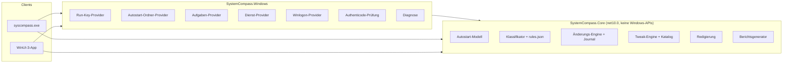

# SystemCompass

**Autostart-Analyse für Windows mit Lese-Priorität — jede Änderung wird verifiziert, protokolliert und kann zurückgenommen werden.**

SystemCompass erfasst die Autostart-Mechanismen, die Windows tatsächlich bereitstellt, erklärt jeden Eintrag und ändert den Zustand ausschließlich über unterstützte Windows-Schnittstellen. Ein Schalter gilt erst dann als umgestellt, wenn der Zustand erneut aus dem System gelesen wurde. Alle Änderungen werden in einem fortlaufenden Journal festgehalten und können zurückgerollt werden.


## Funktionen

| Bereich | Umfang |
|---|---|
| Autostart-Inventar | Run/RunOnce (HKCU/HKLM), Autostart-Ordner (Benutzer und alle Benutzer), geplante Aufgaben mit Start-/Anmeldetrigger, automatische Win32-Dienste, Winlogon Shell/Userinit |
| Klassifikation | Sechs Kategorien (`Keep`, `Optional`, `DisableRecommended`, `Unclear`, `SystemCritical`, `SecurityRelevant`), Risiko, Signatur, Begründung und Wiederherstellung |
| Geschützte Einträge | Windows-Sicherheitskomponenten, Treiberdienste, Fernzugriffssoftware und ausdrücklich geschützte Produkte lassen sich nicht umschalten |
| Reversible Änderungen | `StartupApproved`-Flags wie im Task-Manager, `schtasks /Change`, `sc config`; der vorherige Zustand wird zuerst gesichert |
| Verifikation | Jede Änderung wird aus Registry/SCM/Aufgabenplanung zurückgelesen; eine abweichende Rückmeldung gilt als Fehlschlag |
| Journal | Fortlaufendes JSONL mit Änderungs-ID, Vorher/Nachher, Status und Rollback |
| Snapshots | Vergleich vor/nach einer Bereinigung; neue und erneut aktivierte Einträge werden erkannt |
| Tweak-Katalog | 32 kuratierte Einträge mit Evidenzstufe, gesichertem Vorher-Wert und Ein-Klick-Revert |
| Berichte | Redigierte Markdown-/JSON-Berichte mit Diagnose, Autostart-Zusammenfassung und einem einzelnen Boot-Messwert |
| Demo-Modus | Fiktive Daten für Screenshots und Tests ohne Zugriff auf den Rechner |
| CLI | Skriptfähige Befehle `audit`, `report`, `disable`, `enable`, `rollback`, `tweak`, `data` mit JSON-Ausgabe |

## Sicherheitsmodell

- **Die Analyse ändert nichts.** Der Standardlauf sammelt und klassifiziert nur.
- **Keine Löschung.** Run-Werte werden nicht entfernt; verwendet wird dasselbe `StartupApproved`-Flag, das auch der Task-Manager schreibt. Dienste werden auf Manuell gesetzt, nie deaktiviert und nie gestoppt.
- **Geschützte Einträge** werden über Signatur und Pfad erkannt, nicht nur über den Namen. TeamViewer, Fernzugriffs-Agenten, Windows Security und Treiberdienste bleiben unberührt.
- **Sicherheits-Denylist.** Defender, VBS/HVCI, Exploit-Mitigations, DEP und Windows-Update-Richtlinien werden von der Engine und durch einen Katalogtest abgelehnt.
- **Änderungen auf Maschinenebene** laufen über einen erhöhten Helfer mit erneuter Prüfung und SID-Abgleich; die Intent-Datei wird als nicht vertrauenswürdig behandelt.
- **Fehlgeschlagene Verifikation ist ein Fehlschlag.** Weicht der beobachtete Zustand ab, wird die Änderung als fehlgeschlagen protokolliert.
- **Rollback ist explizit.** Nur verifizierte Änderungen lassen sich auf den zuvor gesicherten Zustand zurücksetzen.

Details: [docs/security-model.md](docs/security-model.md).

## Voraussetzungen

- Windows 10 1809 oder neuer (Windows 11 empfohlen)
- [.NET SDK 10.0.300](https://dotnet.microsoft.com/download) oder neuer
- Administratorrechte nur für Änderungen auf Maschinenebene und Boot-Messungen

Die Desktop-App wird selbsttragend veröffentlicht; zur Laufzeit ist kein Download nötig.

## Bauen und testen

```powershell
dotnet build SystemCompass.slnx -c Release
dotnet test tests/SystemCompass.Tests/SystemCompass.Tests.csproj -c Release
dotnet format SystemCompass.slnx --verify-no-changes
```

CLI:

```powershell
dotnet run --project src/SystemCompass.Cli -c Release -- audit
dotnet run --project src/SystemCompass.Cli -c Release -- report --output bericht.md
```

Desktop-App:

```powershell
dotnet run --project src/SystemCompass.App -c Release
dotnet run --project src/SystemCompass.App -c Release -- --demo
```

## CLI-Referenz

| Befehl | Zweck |
|---|---|
| `audit [--all] [--json] [--demo]` | Klassifizierte Autostart-Einträge anzeigen |
| `report [--json] [--output <datei>] [--demo]` | Redigierten Bericht schreiben |
| `disable <id>` / `enable <id>` | Eine Änderung anwenden, verifizieren und protokollieren |
| `rollback <change-id>` | Zuvor gesicherten Zustand wiederherstellen |
| `tweak list [--json]` | Katalog-Tweaks und aktuellen Status anzeigen |
| `tweak apply <id>` / `tweak revert <id>` | Tweak anwenden oder zurücknehmen |
| `data export --output <datei>` | Redigierten Bericht der lokalen Daten schreiben |
| `data delete --yes` | Lokales Journal und Snapshots löschen |
| `apply-intent <datei> <sid>` | Interner erhöhter Helfer der Desktop-App |

## Architektur



Der plattformneutrale Kern enthält Regeln, Klassifikation, Journal, Verifikation und Redigierung. Die Windows-Projekte übersetzen ausschließlich Registry-, Aufgabenplanungs-, SCM- und Signatur-APIs. Beide Oberflächen teilen sich eine Kompositionsschicht und prüfen daher identisch.

Weiter: [docs/architecture.md](docs/architecture.md) · [Tweak-Datenmodell](docs/tweak-model.md) · [unterstützte Funktionen](docs/supported-features.md).

## Tweaks und Evidenz

Jeder Katalogeintrag nennt Evidenzstufe, Risiko, Windows-Build-Bereich und konkrete Operationen. `MicrosoftDocumented`-Einträge müssen auf `learn.microsoft.com` verlinken; andernfalls schlägt die Katalogprüfung fehl. Operationen sichern den vorherigen Wert und werden anschließend verifiziert.

Der Katalog lehnt sicherheitsreduzierende Einstellungen bewusst ab. Er ist eine kleine kuratierte Auswahl, keine Debloat-Liste, und macht **keine Leistungsversprechen**. Die Definitionen wurden neu aus den eigenen Skripten des Autors und öffentlicher Dokumentation geschrieben; es wird kein Fremdcode übernommen.

## Datenschutz

- Kein Netzwerkcode. `BannedApiAnalyzers` lehnt `HttpClient`, `Socket`, `Dns` und `WebRequest` bereits beim Kompilieren ab.
- Keine Telemetrie, keine Analyse, kein Crash-Upload.
- Journal und Snapshots liegen in `%LOCALAPPDATA%\SystemCompass`.
- Jeder Export wird redigiert: Benutzername, Profilpfade, Rechnername, SIDs und Pfade auf Nicht-Systemlaufwerken.
- `syscompass data delete --yes` entfernt lokale Daten.

Details: [PRIVACY.md](PRIVACY.md).

## Bekannte Einschränkungen

- RunOnce- und Winlogon-Einträge werden angezeigt, sind aber schreibgeschützt.
- Dienste werden auf Manuell gesetzt, nicht gestoppt oder gelöscht; ein Trigger-Start-Dienst kann weiterhin starten.
- Die Boot-Dauer stammt aus einer einzelnen Event-100-Messung und ist kein Benchmark.
- Änderungen auf Maschinenebene benötigen eine interaktive UAC-Bestätigung.
- v0.1 hat keine UI-Automationstests; die Logik ist durch Unit-Tests und schreibgeschützte Integrationstests abgedeckt.
- Lokalisierte Dienstnamen können auf den Dienstschlüsselnamen zurückfallen.

Weitere: [docs/known-limitations.md](docs/known-limitations.md).

## Repository-Struktur

```text
src/SystemCompass.Core      plattformneutral: Modelle, Regeln, Journal, Tweak-Engine, Redigierung
src/SystemCompass.Windows   Registry, Aufgabenplanung, SCM, Signatur, Diagnose
src/SystemCompass.Cli       syscompass.exe
src/SystemCompass.App       WinUI-3-Desktop-App
tests/SystemCompass.Tests   MSTest-Unit- und schreibgeschützte Integrationstests
docs/                       Architektur, Sicherheitsmodell, Roadmap, Beispielbericht
.github/                    CI-, Security-, Dokumentations- und Release-Workflows
```

## Mitwirken und Sicherheit

- [CONTRIBUTING.md](CONTRIBUTING.md)
- [CODE_OF_CONDUCT.md](CODE_OF_CONDUCT.md)
- [SECURITY.md](SECURITY.md) — Sicherheitslücken bitte privat über GitHub melden
- [SUPPORT.md](SUPPORT.md)

## Lizenz und Haftung

MIT — siehe [LICENSE](LICENSE) und [THIRD_PARTY_NOTICES.md](THIRD_PARTY_NOTICES.md).

SystemCompass ist ein unabhängiges Projekt. Es ist **nicht mit Microsoft verbunden, von Microsoft gesponsert oder empfohlen**. Windows ist eine Marke der Microsoft Corporation. Änderungen an Registry, Diensten und geplanten Aufgaben bergen Risiken; lies vor der Nutzung [DISCLAIMER.de.md](DISCLAIMER.de.md) und [DISCLAIMER.en.md](DISCLAIMER.en.md).
