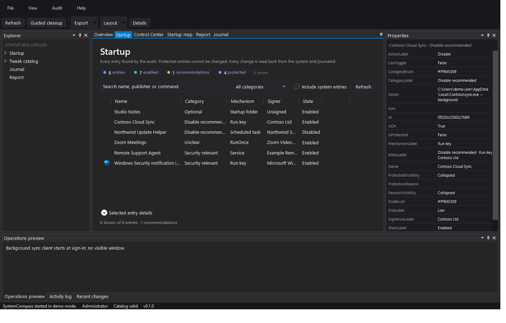
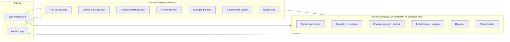

# SystemCompass

**Read-only-first startup auditing for Windows — every change verified, journaled and reversible.**

SystemCompass inventories the startup mechanisms Windows actually exposes, explains what each entry is, and changes state only through supported Windows facilities. A toggle counts as applied only after the state is read back from the system. Everything is recorded in an append-only journal and can be rolled back.



## What it does

| Area | Capability |
|---|---|
| Startup audit | HKCU/HKLM Run and RunOnce, user and all-user Startup folders, scheduled tasks with boot/logon triggers, automatic Win32 services, Winlogon Shell/Userinit |
| Classification | Six categories (`Keep`, `Optional`, `DisableRecommended`, `Unclear`, `SystemCritical`, `SecurityRelevant`), risk, signer, reason and recovery advice |
| Protected entries | Windows security components, driver services, remote-access tooling and explicitly protected products cannot be toggled |
| Reversible changes | Task-Manager-equivalent `StartupApproved` flags, `schtasks /Change`, `sc config`; the previous state is captured first |
| Verification | Every change is re-read from the registry/SCM/scheduler; a failed read-back is reported as failed |
| Journal | Append-only JSONL with change id, before/after, status and rollback support |
| Snapshots | Compare startup state before and after a cleanup; detect new and re-enabled entries |
| Tweak catalog | 32 curated, evidence-labelled definitions with captured previous values and one-click revert |
| Reports | Redacted Markdown/JSON with diagnostics, startup summary and a single boot-duration sample |
| Demo mode | Fictional data for screenshots and evaluation without touching the machine |
| CLI | Scriptable `audit`, `report`, `disable`, `enable`, `rollback`, `tweak`, `data` commands with JSON output |

## Safety model

- **Audit never changes anything.** The default run collects and classifies.
- **No deletion.** Run values are not removed; the same `StartupApproved` flag Task Manager writes is used. Services are set to Manual, never Disabled, and are never stopped.
- **Protected entries** are matched by signature and path, not by name alone. TeamViewer, remote-access agents, Windows Security and driver services stay untouched.
- **Security deny-list.** Defender, VBS/HVCI, exploit mitigations, DEP and Windows Update policies are refused by the tweak engine and by a catalog test.
- **Machine-scope changes** go through one elevated helper with a re-audit and a requester-SID check; the elevated helper treats its intent file as untrusted input.
- **Failed verification is a failure.** A change is journaled as failed if the system does not report the requested state.
- **Rollback is explicit.** Only verified changes can be rolled back, using the state recorded before the change.

See [docs/security-model.md](docs/security-model.md) for the full model.

## Requirements

- Windows 10 1809 or later (Windows 11 recommended)
- [.NET SDK 10.0.300](https://dotnet.microsoft.com/download) or later
- Administrator rights only for machine-scope changes and boot-time measurements

No runtime download is required: the desktop app is published self-contained.

## Build and test

```powershell
dotnet build SystemCompass.slnx -c Release
dotnet test tests/SystemCompass.Tests/SystemCompass.Tests.csproj -c Release
dotnet format SystemCompass.slnx --verify-no-changes
```

Run the CLI:

```powershell
dotnet run --project src/SystemCompass.Cli -c Release -- audit
dotnet run --project src/SystemCompass.Cli -c Release -- report --output report.md
```

Run the desktop app:

```powershell
dotnet run --project src/SystemCompass.App -c Release
```

Demo data (no real entry is read):

```powershell
dotnet run --project src/SystemCompass.Cli -c Release -- audit --demo
dotnet run --project src/SystemCompass.Cli -c Release -- report --demo
dotnet run --project src/SystemCompass.App -c Release -- --demo
```

## CLI reference

| Command | Purpose |
|---|---|
| `audit [--all] [--json] [--demo]` | List classified startup entries. System-critical entries are hidden unless `--all` is given. |
| `report [--json] [--output <file>] [--demo]` | Write a redacted report. |
| `disable <id>` / `enable <id>` | Apply one change, verify it, journal it. |
| `rollback <change-id>` | Restore the state recorded before a verified change. |
| `tweak list [--json]` | Show catalog tweaks and their current state. |
| `tweak apply <id>` / `tweak revert <id>` | Apply or revert one catalog tweak with captured state. |
| `data export --output <file>` | Export a redacted report of local data. |
| `data delete --yes` | Delete the local journal and snapshots. |
| `apply-intent <file> <sid>` | Internal elevated helper used by the desktop app. |

## Architecture



The platform-neutral core owns rules, classification, journaling, verification and redaction. Windows-specific projects only translate registry, scheduler, SCM and signature APIs. Both front ends share one composition root, so they audit the same mechanisms identically.

More: [docs/architecture.md](docs/architecture.md) · [tweak data model](docs/tweak-model.md) · [supported features](docs/supported-features.md).

## Tweaks and evidence

Every catalog entry declares an evidence level, a risk level, an OS build range and explicit operations. `MicrosoftDocumented` entries must link to `learn.microsoft.com`; the validator fails the catalog otherwise. Operations capture their previous value before writing and are verified afterwards.

The catalog deliberately refuses security-reducing settings. It is a small curated set, not a debloat list, and it makes **no performance promises**. Definitions are newly written from the author's own scripts and public documentation; no third-party code is copied.

## Privacy

- No network code. `BannedApiAnalyzers` rejects `HttpClient`, `Socket`, `Dns` and `WebRequest` at compile time.
- No telemetry, no analytics, no crash upload.
- Journal and snapshots live in `%LOCALAPPDATA%\SystemCompass`.
- Every export is redacted: user name, profile paths, machine name, SIDs and non-system drive paths.
- `syscompass data delete --yes` removes local data.

See [PRIVACY.md](PRIVACY.md).

## Known limitations

- RunOnce and Winlogon entries are reported but read-only.
- Services are switched to Manual, not stopped or deleted; a trigger-start service may still start.
- Boot duration comes from a single Event 100 sample and is not a benchmark.
- Machine-scope changes require an interactive UAC prompt.
- v0.1 has no UI automation tests; logic is covered by unit tests and read-only integration tests.
- Localized service display names may fall back to the service key name.

See [docs/known-limitations.md](docs/known-limitations.md).

## Repository layout

```text
src/SystemCompass.Core      platform-neutral models, rules, journal, tweak engine, redaction
src/SystemCompass.Windows   registry, scheduler, SCM, signature and diagnostics providers
src/SystemCompass.Cli       syscompass.exe
src/SystemCompass.App       WinUI 3 desktop app
tests/SystemCompass.Tests   MSTest unit and read-only integration tests
docs/                       architecture, security model, roadmap, sample report
.github/                    CI, security, documentation and release workflows
```

## Contributing and security

- [CONTRIBUTING.md](CONTRIBUTING.md)
- [CODE_OF_CONDUCT.md](CODE_OF_CONDUCT.md)
- [SECURITY.md](SECURITY.md) — report vulnerabilities privately through GitHub
- [SUPPORT.md](SUPPORT.md)

## License and disclaimer

MIT — see [LICENSE](LICENSE) and [THIRD_PARTY_NOTICES.md](THIRD_PARTY_NOTICES.md).

SystemCompass is an independent project. It is **not affiliated with, endorsed by, or sponsored by Microsoft**. Windows is a trademark of Microsoft Corporation. Administration of registry, services and scheduled tasks carries risk; read [DISCLAIMER.en.md](DISCLAIMER.en.md) and [DISCLAIMER.de.md](DISCLAIMER.de.md) before use.
