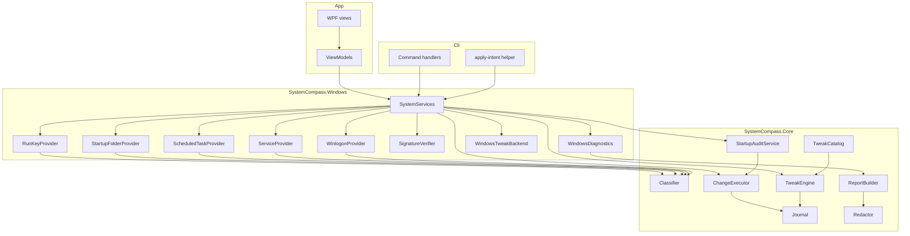
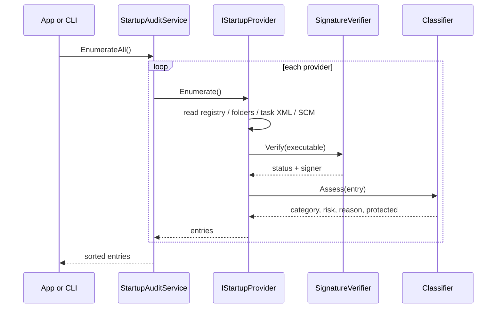
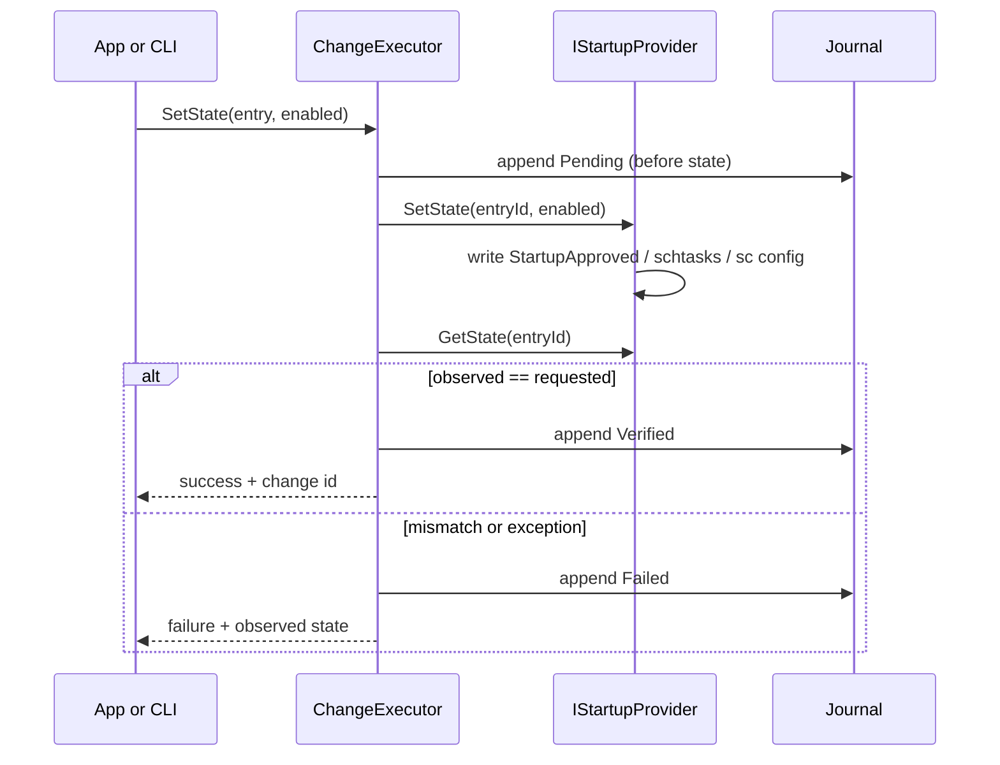

# Architecture

## Principles

1. **Read first, write last.** Enumeration and classification never mutate state.
2. **The core is platform-neutral.** `SystemCompass.Core` targets `net10.0` without Windows SDK references, so Win32 code cannot leak into rules, journaling or redaction.
3. **One composition root.** The CLI and the app construct the same providers and services; there is no second audit implementation for the GUI.
4. **Verify every write.** A change is applied through a supported interface and then read back. A mismatch is a failed change, not a warning.
5. **No network code.** The analyzer configuration rejects network types at compile time.

## Projects

| Project | TFM | Responsibility |
|---|---|---|
| `SystemCompass.Core` | `net10.0` | Models, classifier, change executor, journal, snapshots, tweak engine, redaction, report rendering, demo data |
| `SystemCompass.Windows` | `net10.0-windows10.0.19041.0` | Registry, startup folders, scheduled tasks, services, Winlogon, Authenticode, power APIs, diagnostics, composition root |
| `SystemCompass.Cli` | `net10.0-windows10.0.19041.0` | `syscompass.exe`, JSON output, elevated helper |
| `SystemCompass.App` | `net10.0-windows10.0.19041.0` | WPF (AvalonDock) desktop application, view models, demo mode |
| `SystemCompass.Tests` | `net10.0-windows10.0.19041.0` | Unit tests with fakes; read-only integration tests |

Dependencies point in one direction: `App`/`Cli` → `Windows` → `Core`.

## Component view

## Startup audit flow

## Change flow

Rollback reads the latest verified record for the change id, resolves the entry again, and applies the recorded `Before` state through the same provider. Only verified records are eligible.

## Elevation

The app and CLI run with `asInvoker`. For machine-scope changes:

1. The app writes an intent file to `%TEMP%` containing entry ids and requested states.
2. It starts `syscompass apply-intent <file> <requester-sid>` with `runas`, producing one UAC prompt.
3. The helper validates file size and shape, compares the elevated token's SID with the requester, re-enumerates the entries itself, applies each change through `ChangeExecutor` and writes a result file.
4. The app reads the result and refreshes.

The helper never trusts names or paths from the intent file; it resolves ids against a fresh audit. A different user's elevated token is refused.

## Persistence

| Path | Content |
|---|---|
| `%LOCALAPPDATA%\SystemCompass\journal.jsonl` | Append-only JSONL change records |
| `%LOCALAPPDATA%\SystemCompass\snapshots\` | Snapshot JSON files |
| `%TEMP%\systemcompass-intent-*.json` | Short-lived elevation intent and result |

There is no database, service, driver or background process.

## Testing strategy

- Pure logic is tested with fakes: `IStartupProvider`, `ITweakBackend`, `IJournalStore`.
- `StartupApproved` parsing and creation use byte fixtures.
- Command-line parsing covers quoted paths, environment variables and `rundll32`.
- The catalog validator is a test, so a security-reducing or undocumented tweak fails CI.
- Integration tests are read-only and only run on Windows.
- Write paths are exercised in Windows Sandbox, not on the CI runner.
