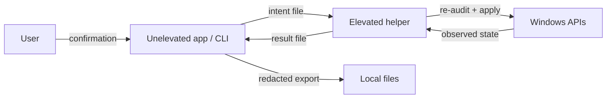

# Security Model

## Assets

- The integrity of the startup configuration.
- The user's personal identifiers in reports and journal exports.
- The privilege boundary between the unelevated app and the elevated helper.
- The integrity of the change journal and rollback data.

## Trust boundaries

| Boundary | Assumption | Control |
|---|---|---|
| User → app | The user is authorized to administer the machine | Confirmation dialog for every change; protected entries cannot be toggled |
| App → helper | The intent file may be modified by any local process | Size limit, schema check, id resolution against a fresh audit, requester-SID comparison |
| Helper → OS | Windows enforces its own access checks | Supported APIs only; no direct memory or driver access |
| App → export | Report content may contain personal data | All exports pass through `Redactor`; no unredacted path |
| Signature → classification | A signer string alone can be spoofed | Protected rules also constrain path and mechanism where possible |

## Threats and mitigations

### Command injection through task or service names

Task names, service names and paths are passed as `ProcessStartInfo.ArgumentList` entries, never as a single command string. No shell is used. This prevents argument splitting and shell metacharacter injection.

### Malicious intent file

The elevated helper accepts only:

- a file smaller than 1 MB,
- a JSON object with 1–100 entries,
- entry ids that resolve through a fresh audit,
- entries that are not protected,
- a matching requester SID.

It refuses to run for a different user's elevated token.

### Over-the-shoulder elevation

If an administrator enters different credentials at the UAC prompt, the elevated token's SID differs from the requester's SID. The helper refuses the batch. This prevents changes from landing in the wrong user's `HKCU` hive or journal.

### Signature spoofing

`SignatureVerifier` returns the trust status and, when available, the signer's simple display name from the verified certificate chain. It does not treat an unsigned file whose name resembles a vendor as that vendor. Protected product rules combine signer and path where possible.

### Network leakage

There is no network code. `BannedApiAnalyzers` makes `HttpClient`, `WebRequest`, `Socket` and `Dns` compile errors. WinVerifyTrust is called with `WTD_CACHE_ONLY_URL_RETRIEVAL`, `WTD_REVOCATION_CHECK_NONE` and no UI.

### Redaction bypass

The report builder accepts only a `Redactor` instance and applies it to every string field. There is no export command that skips redaction. Tests seed a demo report with user names, machine names and company paths and assert that none survive in Markdown or JSON.

### Journal tampering

The journal is a local append-only file. Any local process with write access to the user's profile can modify it. This is accepted: rollback data is not a security boundary against a compromised user account. The tool validates that a rollback target still exists and that the recorded state is a known enum value.

### Protected entries

An entry is protected when a rule marks it, or when its category is `SystemCritical` or `SecurityRelevant`. Protected entries cannot be toggled by the UI, by the CLI, or by the elevated helper.

### Security-reducing tweaks

`SecurityDenyList` rejects operations that target:

- Defender policy and service keys,
- Device Guard / VBS policy keys,
- exploit mitigation overrides,
- LSA configuration,
- Windows Update policies and the update services.

The catalog validator fails CI if such an operation is added.

## Residual risks

- A user with administrator rights can change anything with other tools; SystemCompass cannot prevent that.
- Windows may apply Group Policy or MDM policy that overrides a change; the read-back then reports a failure.
- Localized display names can be misleading; the tool prefers paths and signers for protected classification.
- The journal is not encrypted. It contains entry names and states, not secrets.
- The app is not code-signed in the source repository. Verify release checksums and provenance attestations.

## Reporting

See [SECURITY.md](../SECURITY.md). Never include unredacted reports or journal files in a report.
