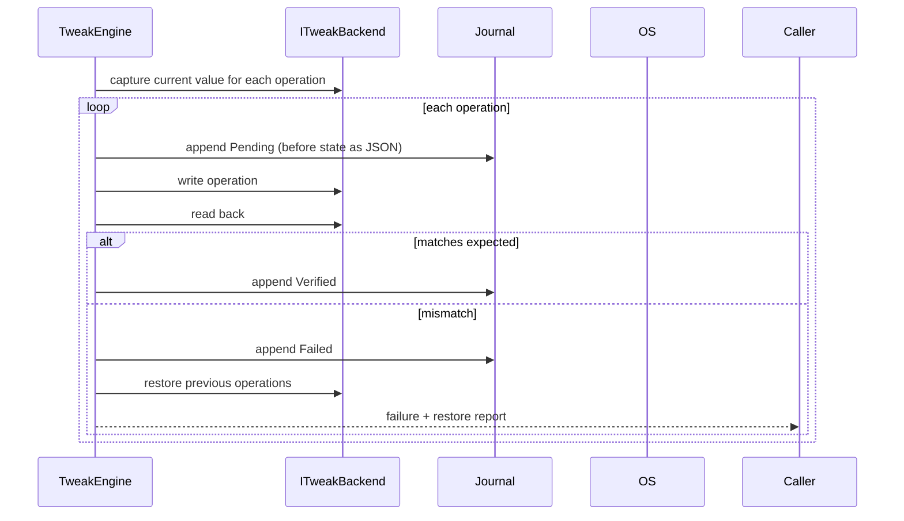

# Tweak Data Model and Rollback

## Definition

A tweak is a declarative JSON object embedded in the assembly (`Tweaks/catalog.json`).

```json
{
  "id": "show-file-extensions",
  "title": "Show file extensions",
  "description": "Makes known file types display their extension in Explorer.",
  "category": "Explorer",
  "evidence": "Community",
  "links": [],
  "risk": "Low",
  "minBuild": 10240,
  "maxBuild": 99999999,
  "requiresElevation": false,
  "requiresReboot": false,
  "operations": [
    {
      "type": "registrySet",
      "hive": "HKCU",
      "keyPath": "Software\\Microsoft\\Windows\\CurrentVersion\\Explorer\\Advanced",
      "valueName": "HideFileExt",
      "kind": "DWord",
      "data": "0"
    }
  ]
}
```

### Fields

| Field | Meaning |
|---|---|
| `evidence` | `MicrosoftDocumented`, `Community` or `Unverified`. Microsoft-documented entries must link to `learn.microsoft.com`. |
| `risk` | `Low`, `Medium` or `High`. Shown before applying. |
| `minBuild` / `maxBuild` | Windows build range. Out-of-range tweaks are `NotApplicable`. |
| `requiresElevation` | The app hands the operation to the elevated helper. |
| `requiresReboot` | Informational; the engine does not reboot. |
| `operations` | Ordered list of concrete changes. |

## Operations

| Type | Fields | Effect |
|---|---|---|
| `registrySet` | hive, keyPath, valueName, kind, data | Create or overwrite a value |
| `registryDelete` | hive, keyPath, valueName | Delete a value |
| `serviceStartType` | serviceName, mode | `sc config <name> start= <mode>` |
| `powerSetting` | subGroup, setting, acValue, dcValue | Active power scheme via PowrProf |

Supported registry kinds: `String`, `ExpandString`, `DWord`, `QWord`, `Binary` (hex string).

## Apply



The previous state is serialized as `TweakOpState` and stored in the journal's `Before` field. If a later operation fails, the operations that already succeeded are restored in reverse order and any restore failure is reported.

## Status

| Status | Meaning |
|---|---|
| `Applied` | All operations match the desired state |
| `NotApplied` | No operation matches |
| `Partial` | Some operations match |
| `NotApplicable` | OS build out of range, or a security-protected operation was refused |

## Revert

`Revert` walks the operations in reverse, finds the latest verified `Apply` record for each operation index and restores the recorded value. If a value did not exist before, it is deleted. Revert also writes `Revert` records.

## Validation

`TweakCatalog.Validate()` enforces:

- unique ids in lower-kebab-case,
- non-empty title, description and operations,
- a valid OS range,
- a `learn.microsoft.com` link for `MicrosoftDocumented`,
- no operation on the `SecurityDenyList`.

The test suite runs this validator, so a violating catalog fails CI.

## Why no `bcdedit` in v0.1

Boot configuration changes are high-impact, partly irreversible and hard to verify without a reboot. They are deliberately deferred until a snapshot mechanism and a reboot-aware verification design exist. See [roadmap](roadmap.md).
